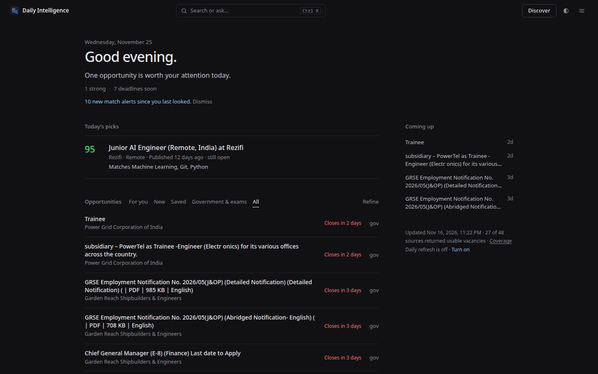
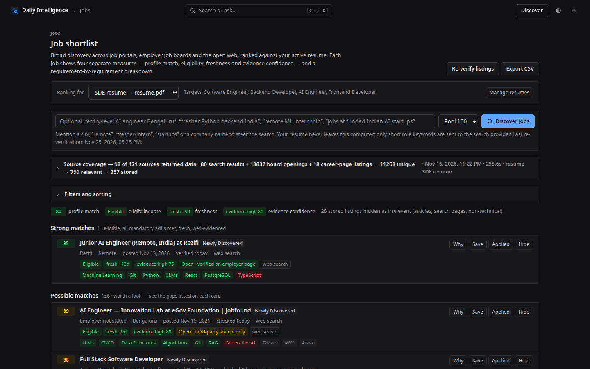
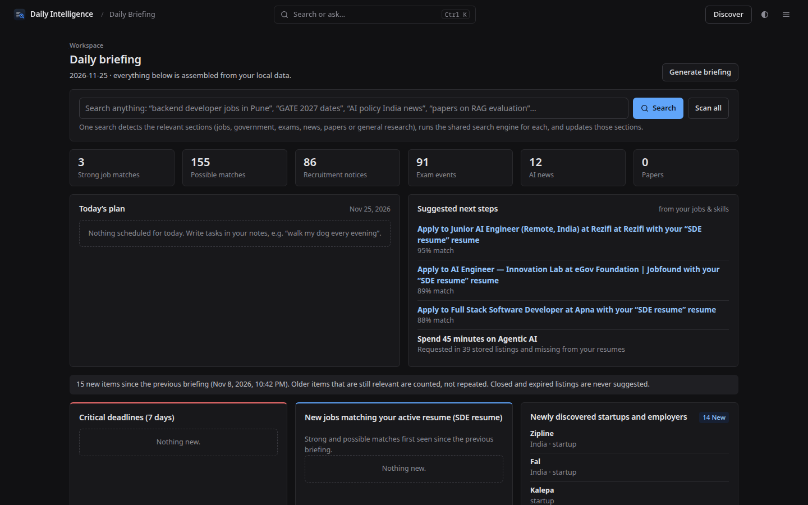
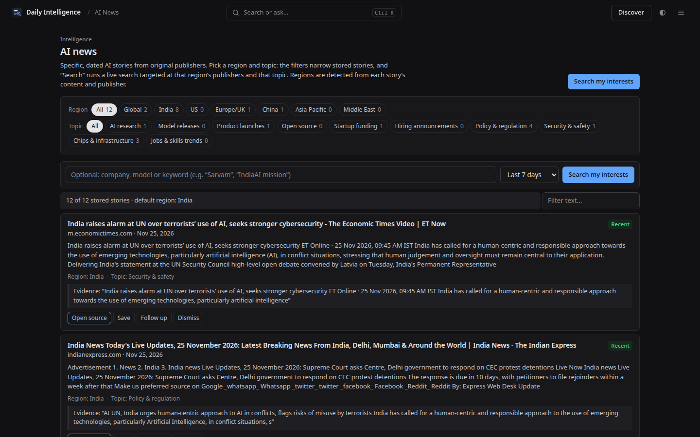
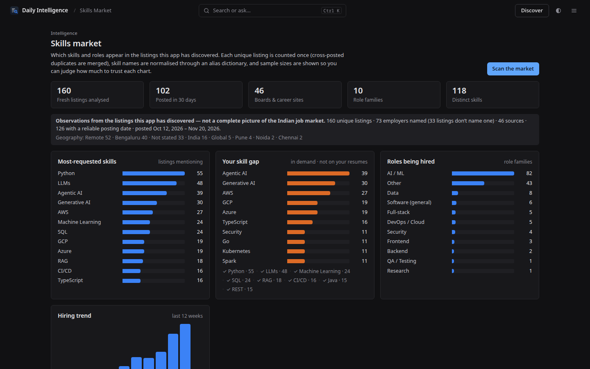
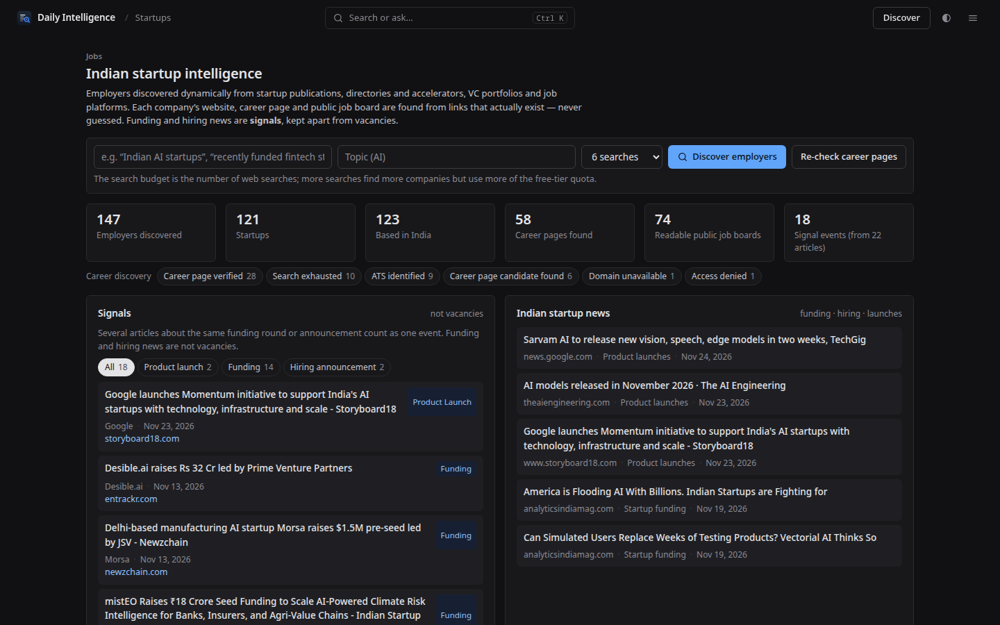
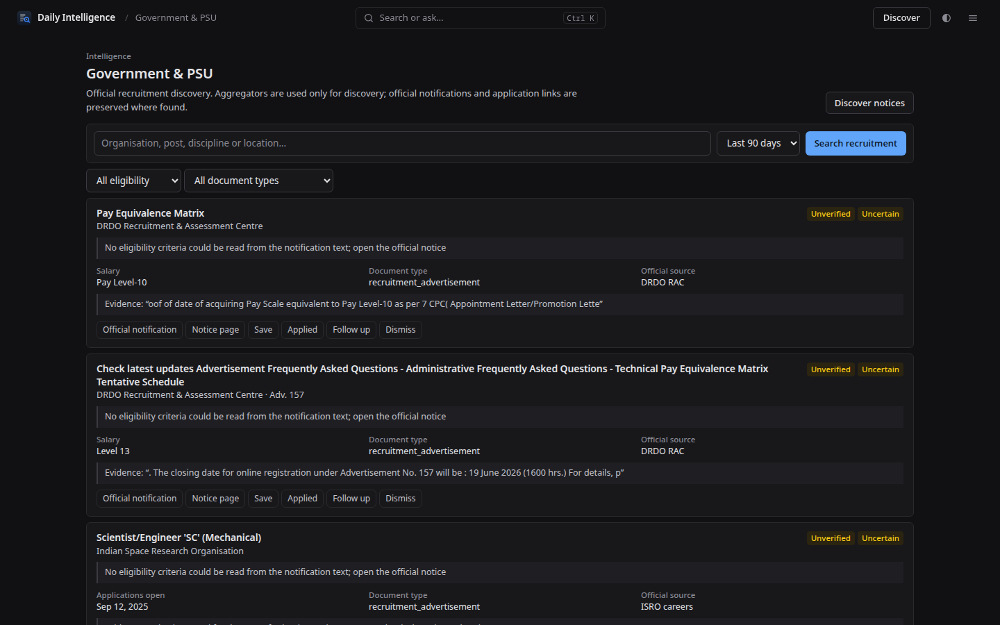
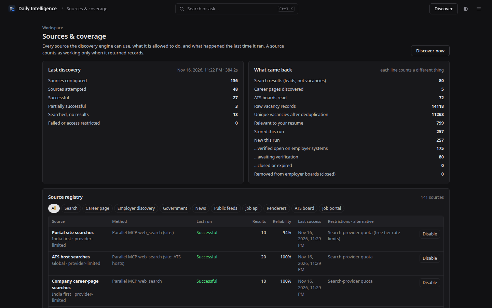
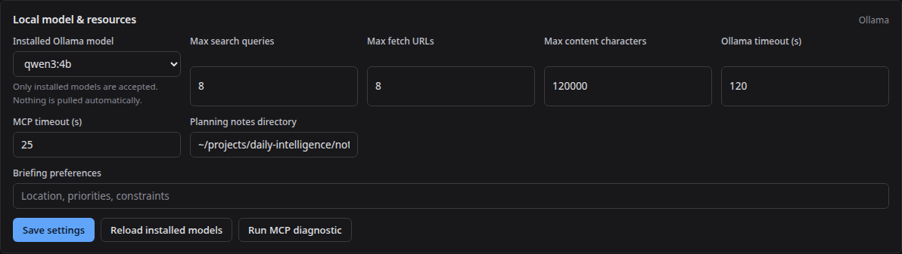

# Daily Intelligence

A personal assistant that runs on my laptop and keeps track of jobs, government/PSU
recruitment, exams and AI news for me, so I don't have to check dozens of sites every day.

Everything runs locally. Language tasks use a small Ollama model on my machine, and my
resume and notes never leave it.



## What it does

- **Jobs** – pulls listings from company career pages, public ATS boards (Greenhouse, Lever,
  Ashby and others), job APIs and web search, then ranks them against my resume.
- **Government & exams** – reads official recruitment and exam sites directly and checks each
  notice against my profile (age, degree, GATE score, category, etc.). Every verdict shows the
  line from the notification it is based on.
- **Company tracking** – rotates through ~280 startups, product companies and GCCs and reads
  their own job boards.
- **News & briefing** – AI news by region and topic, plus a short daily summary of what changed.
- **Applications & planning** – a simple tracker, follow-up reminders and a to-do list built
  from my notes.

One **Discover** button runs all of this and fills a single feed on the home page.

## Screenshots

| | |
| --- | --- |
| **Job shortlist** – ranked against my resume, with the reasons | **Daily briefing** – what changed and what to do next |
|  |  |
| **AI news** – filtered by region and topic | **Skills market** – what employers ask for vs. what my resume has |
|  |  |
| **Startups** – employers, career pages and funding news | **Government & PSU** – official notices with quoted evidence |
|  |  |
| **Sources & coverage** – what every source returned last run | **Local model** – runs on `qwen3:4b` through Ollama |
|  |  |

## How it works

```text
preferences + resume
  -> query plan
  -> official sources, ATS APIs, career pages, search
  -> local model extracts structured data
  -> validation (is it a real vacancy? is it fresh? is it in India / remote-from-India?)
  -> SQLite -> web UI
```

A few rules I stuck to:

- Nothing is made up. If a field isn't in the source text, it's left empty.
- A job is only marked "open" or "closed" when the page actually says so.
- Sites like LinkedIn and Naukri are only used through search results, because their terms
  don't allow scraping. The app reports these gaps instead of hiding them.

## Tech

Python 3.14, SQLite, Ollama (`qwen3:4b`), Playwright for JavaScript-heavy career pages,
Parallel MCP for web search, and a plain HTML/CSS/JS frontend served on `127.0.0.1`.

## Running it

You need Python 3.14, [`uv`](https://github.com/astral-sh/uv) and Ollama with at least one model
installed.

```bash
uv sync
uv run python -m app.main serve      # opens http://127.0.0.1:8765
```

On KDE you can add it to the app menu:

```bash
./scripts/install-desktop.sh
```

Optional API keys (Jooble, Findwork, Firecrawl) can be added later from **Settings → API keys**.
The app works without them.

## Tests

```bash
uv sync --dev
./.venv/bin/python -m pytest -q
```

## Notes

- Built and tested on Fedora. It should work on other Linux setups but I haven't tried.
- Coverage is never complete. Some sites block automated requests, and that's reported in
  the Sources page.
- More detail: [ARCHITECTURE.md](ARCHITECTURE.md) and [CHANGELOG.md](CHANGELOG.md).
